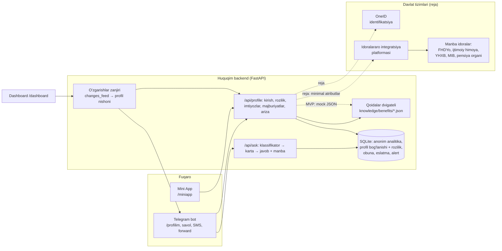

# Huquqim — arxitektura

> Holat: hackathon MVP. **MyGov (OneID) ulanishi hozircha MOCK** (3 ta soxta profil: `knowledge/mock_profiles/`).
> Barcha huquqiy mazmun `verified: false`; aniq modda, summa va shartlar o'rnida `TODO_LAWYER` turibdi.
> Quyidagi "real ulanish" bo'limi — **reja**. Rasmiy texnik spetsifikatsiyalar (OneID, integratsiya platformasi)
> va huquqiy talablar jamoa huquqshunosi va operator idoralar bilan tasdiqlanadi.

## 1. Umumiy ko'rinish

Bitta backend va uchta yuz: Telegram bot, Telegram Mini App («Mening huquqlarim»), web dashboard (davlat uchun).
Ta'lim moduli (loyiha brifidagi 6–8-muammolar) mentor qarori bilan hozircha to'xtatilgan.



## 2. «Mening huquqlarim» — hozirgi MVP

| Qism | Fayl | Vazifa |
|---|---|---|
| Soxta profillar | `knowledge/mock_profiles/*.json` | 2 bolali ona, pensioner, yosh haydovchi. Oila tarkibi, bolalar yoshi, ijtimoiy holat, jarima/MIB qarzi, hudud |
| Imtiyozlar | `knowledge/benefits/*.json` | 5 ta imtiyoz/huquq: `rule` (shartlar), hujjatlar, qayerga, `legal_basis`, ariza shabloni |
| Qoidalar dvigateli | `backend/app/services/profile.py` | Profil → minimal faktlar → har shart: bajarildi / bajarilmadi / **noma'lum** |
| API | `backend/app/api/profile.py` | `demo-profiles`, `login` (rozilik majburiy), `me`, `logout`, `appeal`, `remind` |
| Bot | `bot/handlers.py` | `/profilim`, profil tanlash = rozilik, har imtiyozdan 📝 tayyor ariza, ⏰ eslatma |
| Mini App | `frontend/src/MiniApp.jsx` | Kirish → rozilik → profil: imtiyozlar, majburiyatlar, menga ta'sir qiluvchi o'zgarishlar |

**Natija hech qachon "albatta olasiz" emas.** Bajarilgan shartlar ✓ bilan, `TODO_LAWYER` shartlar
"❔ Tekshirilishi kerak" bilan ko'rsatiladi. Yakuniy status — «Haqli bo'lishingiz mumkin». Yakuniy qarorni vakolatli organ qabul qiladi.

### O'zgarishlar zanjiri → faqat ta'sir qiladigan profillar
1. Dashboard'da «⚡ O'zgarishni simulyatsiya qilish» bosiladi. `changes_feed.json` dan o'zgarish olinadi (`ref_id`).
2. Har bir profil uchun `relevant_refs` hisoblanadi: mos keladigan imtiyozlarning `legal_basis.ref_id` lari va
   majburiyatlar kartalarining `ref_id` lari.
3. `ref_id` mos kelgan profilga ulangan foydalanuvchilarga **shaxsiy** alert yoziladi ("Nega sizga: …").
   Mos kelmaganlarga xabar **bormaydi**.
4. Mavzuga o'zi obuna bo'lganlar ham xabar oladi. Bitta foydalanuvchiga bitta xabar boradi.
5. Kartalar "qayta tekshirish kerak" bo'ladi. Dashboard kimga borgani va kimga bormaganini ko'rsatadi.

Namuna: bolalar nafaqasi o'zgarishi faqat onaga boradi. Pensiya o'zgarishi faqat pensionerga boradi. Mehnat (ish haqi) o'zgarishi hech kimga bormaydi.

### SQLite'da nima saqlanadi (va nima saqlanmaydi)
| Saqlanadi | Saqlanmaydi |
|---|---|
| `profile_links`: `user_key` (Telegram chat_id yoki `web:<tasodifiy>`), `profile_id`, rozilik vaqti, doirasi, matn versiyasi | Profil ma'lumotlari (oila, bolalar, qarzlar): har so'rovda manbadan o'qiladi |
| `subscriptions`: mavzu obunasi | F.I.Sh., PINFL, pasport, telefon |
| `reminders`, `alerts`: eslatma va xabar matni (shaxsiy identifikatorsiz) | Savol matni (analitikada faqat mavzu/hudud/til/kanal) |
| `events`: anonim analitika | |

Rozilikni bekor qilish (`/profilim` → «Chiqish» yoki Mini App'dagi tugma) bog'lanish yozuvini o'chiradi.

### Autentifikatsiya (hozir)
- **Mini App:** `X-Telegram-Init-Data` sarlavhasi. Bot tokeni bilan HMAC-SHA256 orqali tekshiriladi (Telegram'ning rasmiy algoritmi) va 24 soat ichida eskiradi.
- **Bot → backend:** chat_id va `X-Internal-Token` (`INTERNAL_API_TOKEN`). Prod'da bu token **majburiy**.
- **Brauzer (demo):** `web:<tasodifiy-id>`. Bunday kalit bilan birovning Telegram chat_id'si nomidan ish ko'rib bo'lmaydi.

## 3. Real ulanish rejasi: OneID + idoralararo integratsiya platformasi

### 3.1. Oqim
```mermaid
sequenceDiagram
  participant U as Fuqaro (bot / Mini App)
  participant H as Huquqim backend
  participant O as OneID
  participant I as Integratsiya platformasi
  participant S as Manba idora
  U->>H: «MyGov (OneID) orqali kirish»
  H->>U: Rozilik ekrani: maqsad + aniq atributlar ro'yxati + muddat
  U->>O: OneID'da autentifikatsiya (redirect)
  O->>H: Avtorizatsiya kodi → token (faqat sessiya uchun)
  H->>I: Imzolangan so'rov: faqat kerakli atributlar (masalan "18 yoshgacha bolalar soni")
  I->>S: Idoralararo so'rov
  S-->>I: Javob
  I-->>H: Minimal javob
  H->>H: Xotirada qoidalarni baholash → natija
  H-->>U: Imtiyozlar / majburiyatlar / o'zgarishlar
  Note over H: Javob yuborilgach xom atributlar xotiradan o'chadi; DB'ga yozilmaydi
```

### 3.2. Rozilik (consent)
- **Aniq va maqsadli.** Har bir maqsad (imtiyozni tekshirish, majburiyat eslatmasi, o'zgarish xabari) uchun alohida belgi qo'yiladi. Ekranda o'qiladigan atributlar ro'yxati va manba idora ko'rsatiladi.
- **Ixtiyoriy.** Rozi bo'lmagan fuqaro botdan to'liq foydalanadi (savol, SMS, fakt-tekshiruv). Faqat profil qismi ishlamaydi.
- **Bekor qilinadigan.** Bir bosish bilan («Chiqish»). Bog'lanish, obunalar va kutilayotgan eslatmalar o'chadi.
- **Isbotlanadigan.** Rozilik jurnali shaxsiy ma'lumotsiz yuritiladi: psevdonim, doira, matn versiyasi, vaqt.
- **Huquqiy asos.** «Shaxsga doir ma'lumotlar to'g'risida»gi Qonun talablari: rozilik shakli, operator va mulkdor majburiyatlari, ma'lumotlarni lokalizatsiya qilish. Aniq moddalar `TODO_LAWYER`.

### 3.3. Minimal ma'lumot (data minimization)
- Qoidalar dvigateli **faktlar** bilan ishlaydi, xom hujjat bilan emas. Hozirgi faktlar (`profile.facts`):
  `minor_children`, `single_parent`, `low_income_registry`, `is_pensioner`, `lives_alone`,
  `fines_with_active_discount`, `region`.
- Integratsiya platformasidan iloji boricha **hosila atributlar** so'raladi, masalan "18 yoshgacha bolalar soni: 2".
  Tug'ilgan sanalar, F.I.Sh. yoki PINFL bilan kelgan to'liq yozuv so'ralmaydi.
- Qaysi imtiyoz qaysi faktni talab qilishi `benefits/*.json` dagi `rule` dan **avtomatik** chiqariladi.
  Shuning uchun so'rov doirasi rozilik ekranida aniq ko'rinadi va keraksiz maydon so'ralmaydi.
- Arizaga ism kabi ma'lumot faqat javob matniga qo'yiladi. Serverda saqlanmaydi.

### 3.4. Saqlamaslik (no storage)
- Profil atributlari faqat so'rov davomida **xotirada** turadi. Diskka, DB'ga, logga va keshga yozilmaydi.
- DB'da qoladiganlar: psevdonimli bog'lanish (OneID sub/token hash, xom identifikator emas) va rozilik yozuvi.
- O'zgarishlarni nishonlash uchun **ma'lumot saqlanmaydi**. Yangi o'zgarish chiqqanda rozilik bergan foydalanuvchilar uchun atributlar qayta so'raladi (qisqa navbat). Muqobil variant: faqat hosila "ref_id obunalari" saqlanadi (masalan `REF_CHILD_ALLOWANCE_1`). Ular shaxsiy ma'lumot emas, lekin baribir rozilik doirasida.
- Loglarda `user_key` xeshlanadi. Shaxsiy maydonlar log formatlovchida filtrlanadi.

### 3.5. Xavfsizlik
- Integratsiya platformasi bilan o'zaro TLS (mTLS), imzolangan so'rovlar, IP allowlist. Shartlari platforma operatori reglamenti bo'yicha (TODO).
- OneID tokenlari faqat server tomonida, qisqa muddatli. Refresh token saqlanmaydi.
- `ADMIN_TOKEN` (dashboard) va `INTERNAL_API_TOKEN` (bot) prod'da majburiy. Sirlar faqat `.env` / secret store'da.
- Audit: kim, qachon, qaysi atribut doirasida so'rov yubordi. Audit davlat tomonida yuritiladi, bizda faqat psevdonim.
- Ma'lumotlar O'zbekiston hududidagi serverlarda saqlanadi va qayta ishlanadi (lokalizatsiya talabi — `TODO_LAWYER` tasdiqlasin).

### 3.6. Bosqichlar
| Bosqich | Nima | Holat |
|---|---|---|
| 0 | Mock profillar, qoidalar dvigateli, rozilik UX, profilga nishonlangan alertlar | ✅ MVP |
| 1 | Huquqshunos `benefits/*.json` ni to'ldiradi: shartlar, summalar, `legal_basis` → `verified: true` | Kutilmoqda |
| 2 | OneID integratsiyasi: `login` endpointi mock tanlov o'rniga OneID redirect bilan ishlaydi | Rasmiy ruxsat va spetsifikatsiya kerak |
| 3 | Integratsiya platformasi orqali 2–3 ta atribut, masalan bolalar soni va ijtimoiy reestr belgisi. Pilot bitta hududda | Adliya vazirligi pilotida |
| 4 | Jarima/MIB majburiyatlari real manbadan, muddat eslatmalari | Keyin |

Kodda o'zgaradigan joy bitta: `profile.view()` / `knowledge.mock_profiles()` → `ProfileSource` interfeysi
(`MockSource` → `OneIdIipSource`). Qoidalar, UI, alertlar va arizalar o'zgarmaydi.

## 4. Qolgan qismlar (qisqa)
- **Savol-javob:** klassifikator (trigger + TF-IDF) → vaziyat kartasi → javob. LLM faqat qayta ifodalaydi; kartada yo'q raqam yoki havola chiqsa, javob rad etiladi. Har javobda manba va ogohlantirish bor. Hech narsa topilmasa: "tasdiqlangan ma'lumot topilmadi".
- **SMS tahlili:** regex orqali ism va tug'ilgan sana olib tashlanadi, summa, chegirma, muddat va organ ajratiladi.
- **Fakt-tekshiruv:** ma'lum da'volar bazasi. Manba yo'q bo'lsa, hukm "Tasdiqlanmagan".
- **Dashboard:** anonim analitika (14 hudud, trend, top mavzular), targ'ibot kontenti, feyk signallar, o'zgarishlar zanjiri.
- **Tashqi chaqiruvlar:** LLM, STT, TTS, Telegram, bot→backend — hammasida timeout va fallback bor.
